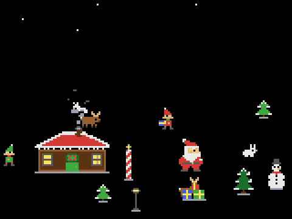

# North Pole

A retro holiday screen saver module for [Afterglow](https://morphing.cloud/afterglow)

## How to install

You need a Mac with **macOS 14 (Sonoma) or later**.

1. Download and install [Afterglow](https://morphing.cloud/afterglow). If you already have it, ensure you're on the latest version, as North Pole may not install properly with older versions.
2. Download the [North Pole screensaver module](https://github.com/pozdena/northpole-afterglow/releases/latest/download/NorthPole.hqx).
3. Drag the downloaded NorthPole.hqx file onto Afterglow's window. It will appear in the list as "North Pole" under Third Party Modules.
4. Open your macOS System Settings. Go to Wallpaper -> Screen Saver (on
   some versions it's just Screen Saver) and select Afterglow. If Afterglow isn't
   there, open the Afterglow app, choose "Install Afterglow Screen Saver" from its menus,
   and look again.
5. Still in Screen Saver, click "Options…" under Afterglow, choose
   "North Pole" (and optionally enable "CRT Effect" for extra retro feel) and close the sheet.

## Development

For technical details about how this module works, see [DEVELOPMENT.md](DEVELOPMENT.md).

## License

[MIT](LICENSE).
